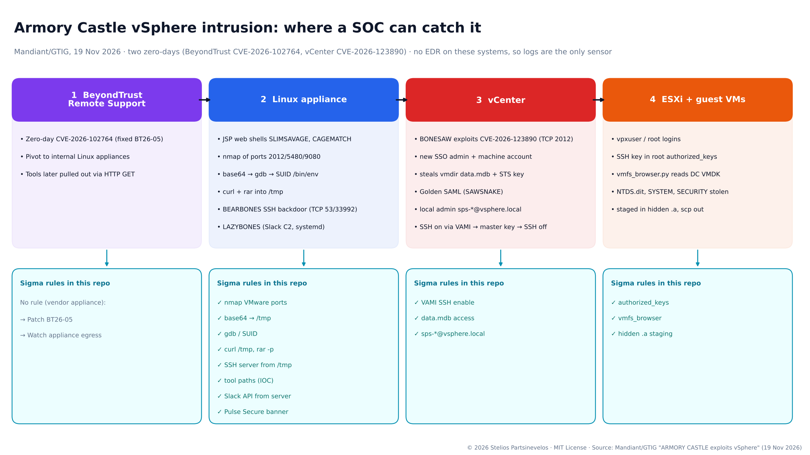

# Armory Castle vCenter Zero-Day: Detection Engineering for vSphere

**Case study: suspected PRC-nexus espionage campaign exploiting VMware vCenter CVE-2026-123890 (disclosed 19 November 2026)**

Detection engineering for an intrusion that moved through **four systems without EDR**: BeyondTrust Remote Support → Linux appliance → vCenter → ESXi. This repo includes **13 Sigma rules** (with Splunk SPL), a **MITRE ATT&CK v20.1** layer that separates *observed* from *detected* techniques, and a **hunting & hardening checklist**.



---

## Why this project

On 19 November 2026, [Mandiant and Google Threat Intelligence Group (GTIG)](https://cloud.google.com/blog/topics/threat-intelligence/armory-castle-exploits-vsphere) published how **ARMORY CASTLE** (formerly UNC5221, also tracked as Warp Panda) used **two zero-days** in one intrusion. Broadcom disclosed and patched the vCenter flaw the same day ([VMSA-2026-0009](https://support.broadcom.com/web/ecx/support-content-notification/-/external/content/SecurityAdvisories/0/39495), CVSS 9.8), and CISA added it to the [KEV catalog](https://www.cisa.gov/known-exploited-vulnerabilities-catalog) on 20 November.

vCenter is the control plane for every virtual machine in a company. Whoever controls it can read the disks of domain controllers. That is exactly what happened here: the actor ended up extracting **NTDS.dit** from a guest DC's virtual disk.

The key lesson for a SOC: **vCenter, ESXi and appliances have no EDR.** If their logs are not in the SIEM, this attack is invisible.

## Timeline

| Date (2026) | Event |
|---|---|
| 29 Aug | ARMORY CASTLE starts exploiting BeyondTrust CVE-2026-102764 as a zero-day |
| Early Sep | vCenter exploited with BONESAW (CVE-2026-123890), more than two months before a patch |
| 8 Oct | BeyondTrust ships the BT26-05 patch |
| 15 Oct | BeyondTrust advisory BT26-05 and Mandiant analysis published |
| 16 Oct | CISA adds CVE-2026-102764 to KEV |
| 19 Nov | Broadcom VMSA-2026-0009 and Mandiant/GTIG vSphere report published |
| 20 Nov | CISA adds CVE-2026-123890 to KEV |

## The attack chain (as reported by Mandiant)

| Stage | What happened |
|---|---|
| **1. Initial access** | Zero-day **CVE-2026-102764** in BeyondTrust Remote Support (fixed in [BT26-05](https://www.beyondtrust.com/trust-center/security-advisories/bt26-05)) |
| **2. Linux appliance** | JSP web shells (SLIMSAVAGE, CAGEMATCH), nmap of VMware ports, base64 → gdb → SUID on `/bin/env` for root, BEARBONES SSH backdoor, LAZYBONES with Slack C2 |
| **3. vCenter** | **BONESAW** exploits **CVE-2026-123890** (vmdir auth bypass, TCP 2012): new SSO admin + machine account, theft of `data.mdb` and the STS SAML signing key, **Golden SAML** (SAWSNAKE). Local admin `sps-*@vsphere.local`. SSH turned on via VAMI, master key and PostgreSQL credentials stolen, SSH turned off |
| **4. ESXi** | Logins as `vpxuser` and `root`, SSH key planted, `vmfs_browser.py` reads a Windows guest disk → **NTDS.dit, SYSTEM, SECURITY**. Data staged in a hidden `.a` folder and moved out with scp |

**Patch status**

- **vCenter:** fixed in **9.1.1.0200, 9.0.2.0200, 8.0 U3m** and VCF **5.2.5**. Broadcom lists **no workaround**, so patching is the only fix. vCenter **7.0** is past end of general support and has no fixed build listed: treat it as vulnerable and plan an upgrade.
- **BeyondTrust Remote Support:** versions **≤ 26.2.3** are affected. Apply patch **BT26-05-RS**. Versions older than 24.3.1 must upgrade first.

---

## Repository contents

| Path | What it is |
|---|---|
| [`detections/sigma/`](detections/sigma) | 13 Sigma rules across Linux process creation, vCenter/VAMI web logs, vCenter SSO logs, ESXi shell logs, proxy and Zeek |
| [`detections/splunk_queries.md`](detections/splunk_queries.md) | The same rules converted to Splunk SPL with pySigma |
| [`hunting/hunting-and-hardening.md`](hunting/hunting-and-hardening.md) | First-24h actions, hunting checklist per system, response order for Golden SAML, hardening table |
| [`layers/attack-layer.json`](layers/attack-layer.json) | ATT&CK Navigator layer: 34 techniques, 18 covered by rules in this repo |
| `vcenter-attack-chain.png` | Attack chain with the detection points per stage |

## Quick start

Validate the rules and convert them yourself with [sigma-cli](https://github.com/SigmaHQ/sigma-cli):

```bash
pip install sigma-cli
sigma plugin install splunk
sigma check detections/sigma/
sigma convert -t splunk --without-pipeline detections/sigma/
```

`--without-pipeline` keeps the generic field names. Add a processing pipeline (or edit the output) to map them to your own sourcetypes and fields.

## Detections

| # | Rule | Log source | ATT&CK | Level |
|---|---|---|---|---|
| 1 | SSH enabled through the VAMI REST API | vCenter/VAMI access log | T1021.004 | high |
| 2 | SSO account matching `sps-*@vsphere.local` | vCenter SSO log | T1136.001 | high |
| 3 | vmdir database `data.mdb` accessed by non-vmdird process | Linux process creation | T1552.001 | critical |
| 4 | gdb command file or SUID set on shell-capable binary | Linux process creation | T1548.001, T1059.004 | high |
| 5 | base64 decoded into `/tmp` | Linux process creation | T1140 | medium |
| 6 | curl download to `/tmp` or password-protected RAR extraction | Linux process creation | T1105, T1140 | medium |
| 7 | SSH server started from `/tmp` (BEARBONES pattern) | Linux process creation | T1571, T1556 | critical |
| 8 | Campaign tool paths (BONESAW, SAWSNAKE, BEARBONES, LAZYBONES) | Linux process creation | T1059.004, T1036.005 | critical |
| 9 | nmap scan of VMware management ports | Linux process creation | T1046 | high |
| 10 | ESXi: SSH key added, hidden VMFS staging, vmfs_browser | ESXi `shell.log` | T1098.004, T1074.001, T1006, T1003.003 | high |
| 11 | Server calling Slack API endpoints used for C2 | Proxy | T1102.002 | high |
| 12 | SSH banner spoofing Pulse Secure (`pulsesecure_23345`) | Zeek `ssh.log` | T1036 | high |
| 13 | scp to or from an ESXi VMFS datastore (data pulled out of ESXi) | Linux process creation | T1048.002, T1021.004 | high |

**Design choice:** most rules detect **behaviour** (SSH enablement, SUID, `/tmp` execution, vmdir access) rather than file hashes. Mandiant published no hashes, and paths and names are cheap for an actor to change. Rule 8 is the only pure IOC rule.

## ATT&CK mapping

Mandiant's post lists **no ATT&CK IDs**. The mapping in this repo is my own, built from the reported behaviour and checked against [ATT&CK v20.1](https://attack.mitre.org/). In the layer, **dark red** marks techniques observed *and* covered by a rule here, and **light** marks observed techniques that need hunting instead (see the checklist).

**Biggest gap: Golden SAML (T1606.002).** Forged tokens look like normal logins, so no rule here catches their use. The defence is to protect the STS signing key, hunt for its theft, and rotate it after any suspected vCenter compromise (response order in [`hunting/hunting-and-hardening.md`](hunting/hunting-and-hardening.md)).

Open the layer: [ATT&CK Navigator](https://mitre-attack.github.io/attack-navigator/) → *Open Existing Layer* → *Upload from local* → `layers/attack-layer.json`.

---

## Limitations

- Mandiant published **no hashes and no log file paths**. Field names in the rules (`Image`, `CommandLine`, `cs-uri-stem`, `server`) must be mapped to your own log sources.
- Rules 2 and 10 use **custom log sources** (`product: vmware`) and keyword matching, because vCenter SSO and ESXi shell logs have no standard Sigma taxonomy.
- The rules have passed pySigma validation and convert to Splunk, but have **not been tested against live vSphere telemetry**.
- Mandiant's text gives TCP 2012 for the exploit but "TCP 2010" in one hardening table. Verify ports before writing firewall rules.
- Attribution is Mandiant's (**suspected** PRC-nexus). This repo does not add independent attribution.

## Sources

**Primary**
- Mandiant / GTIG, [ARMORY CASTLE Exploits vSphere](https://cloud.google.com/blog/topics/threat-intelligence/armory-castle-exploits-vsphere) (19 Nov 2026)
- Mandiant / GTIG, [ARMORY CASTLE exploits BeyondTrust](https://cloud.google.com/blog/topics/threat-intelligence/armory-castle-exploits-beyondtrust) (15 Oct 2026)
- Broadcom, [VMSA-2026-0009](https://support.broadcom.com/web/ecx/support-content-notification/-/external/content/SecurityAdvisories/0/39495) (19 Nov 2026)
- BeyondTrust, [Security advisory BT26-05](https://www.beyondtrust.com/trust-center/security-advisories/bt26-05) and [blog post](https://www.beyondtrust.com/blog/entry/bt26-05) (15 Oct 2026)
- CISA, [Known Exploited Vulnerabilities catalog](https://www.cisa.gov/known-exploited-vulnerabilities-catalog)

**Reporting**
- SecurityWeek, [Newly Patched VMware vCenter Flaw Exploited as Zero-Day by Chinese APT](https://securityweek.com/newly-patched-vmware-vcenter-flaw-exploited-as-zero-day-by-chinese-apt)
- SecurityOnline, [vCenter zero-day CVE-2026-123890 exploited](https://securityonline.info/vcenter-zero-day-cve-2026-123890-exploited/) (versions, VMSA-2026-0009, KEV)
- Cybersecurity Dive, [Chinese espionage group exploits VMware vCenter zero-day](https://www.cybersecuritydive.com/news/chinese-espionage-zero-day-flaw-vmware-vcenter/875273/)
- Rapid7, [CVE-2026-123890: Critical Authentication Bypass in VMware vCenter](https://www.rapid7.com/blog/post/etr-cve-2026-123890-critical-authentication-bypass-vmware-vcenter)

**vSphere defence background**
- Mandiant, [From Help Desk to Hypervisor: Defending Your VMware vSphere Estate from UNC3944](https://cloud.google.com/blog/topics/threat-intelligence/defending-vsphere-from-unc3944/)
- Mandiant, [vSphere and BRICKSTORM Malware: A Defender's Guide](https://cloud.google.com/blog/topics/threat-intelligence/vsphere-brickstorm-defender-guide) and the [vCenter hardening tool](https://github.com/mandiant/vcsa-hardening-tool)
- [MITRE ATT&CK Enterprise v20.1](https://attack.mitre.org/)

## License & attribution

© 2026 Stelios Partsinevelos. Released under the MIT License (see [LICENSE](LICENSE)).

MITRE ATT&CK® is a registered trademark of The MITRE Corporation. VMware and vCenter are trademarks of Broadcom. This project is not affiliated with Mandiant, Google, Broadcom or BeyondTrust. Rules are provided as-is for defensive use. Test before production.
